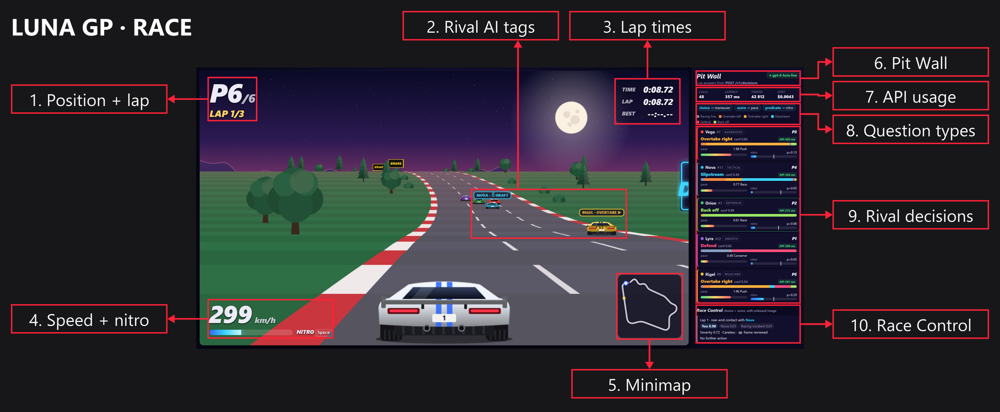
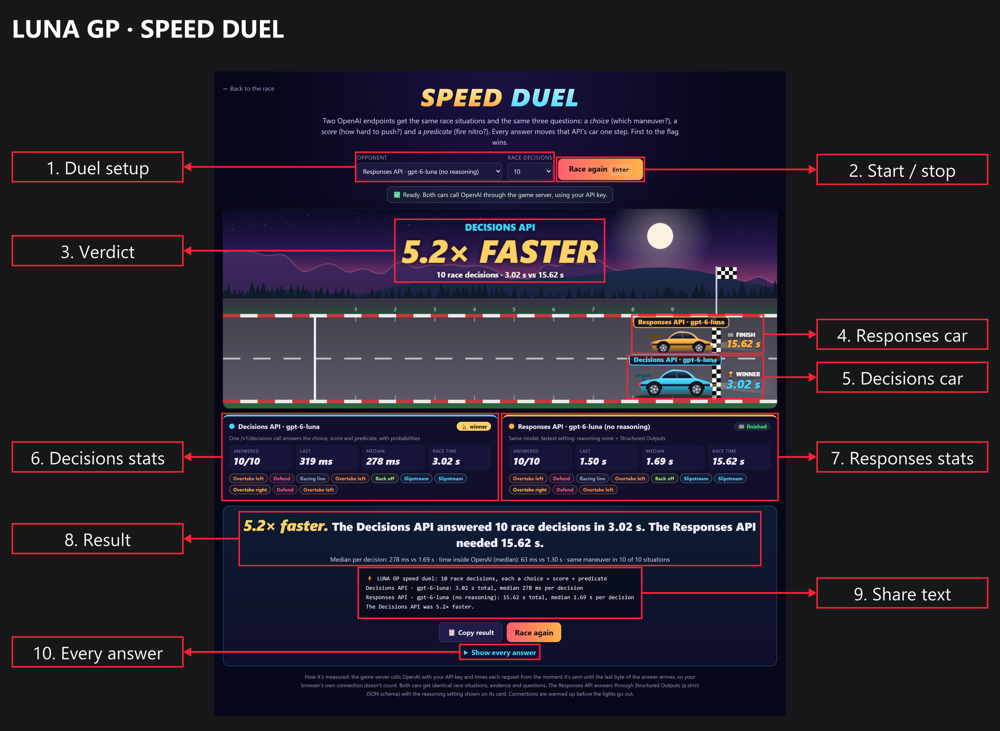

# LUNA GP

A pseudo-3D night-time arcade racer in which every rival driver, the race stewards and the post-race debrief are powered by
[Microsoft-Decision-1](https://ai.azure.com/catalog/models/Microsoft-Decision-1) on Microsoft Foundry
(`POST <foundry-endpoint>/providers/microsoft/v1/systemone`).

You drive. The game engine handles physics. Microsoft-Decision-1 makes the rivals' tactical calls: it answers typed
questions (`choice`, `score`, `noul`) with probabilities instead of generating text.

Want to see how fast it is? The **Speed Duel** races two ways of asking the model the same questions, live. See
[Speed duel](#speed-duel).

## Race screen

The race view combines the arcade driving HUD with live decision telemetry. The highlighted areas show where to
find race progress, driving information, rival decisions and Race Control rulings.



## Live deployment

The game runs on Azure App Service and talks to the model with its **system-assigned managed identity** (no keys):

| Resource | Name | Region |
| --- | --- | --- |
| Web app (Linux, Node 22, P0v3) | `luna-gp-45684` → <https://luna-gp-45684.azurewebsites.net> | Central US |
| Foundry resource | `aoai-dxvm6vcbss5dg` (resource group `rg-genai-java`) | East US 2 |
| Model deployment | `decision-1-dz`: Microsoft-Decision-1 v1, **DataZoneStandard** (US), 500 requests/min | US data zone |
| Role assignment | web app identity → **Cognitive Services User** on the Foundry resource | – |

The web app and the model deployment are in the same US data zone. App Service had no quota in East US 2 in this
subscription, so the app runs in Central US; requests stay inside the US data zone either way.

**Throughput:** one deployment allows up to 500 requests/min (the subscription's DataZoneStandard quota). A race makes about
300 rival calls a minute, so one deployment supports one or two simultaneous races. For more, add deployments in other
quota pools (GlobalStandard, or another data zone) or request a quota increase in the Foundry portal.

> The site is public and unauthenticated: anyone with the URL can start races, which uses your model quota and is billed to
> the subscription. The server caps work at 16 decisions in flight. Stop the app (`az webapp stop -g rg-genai-java -n luna-gp-45684`) when you're not using it.

### Deploy it yourself

```powershell
$rg = "rg-genai-java"; $app = "luna-gp-<unique>"; $foundry = "aoai-dxvm6vcbss5dg"

# 1. Model: Microsoft-Decision-1 (deployment names can't contain "Microsoft")
az cognitiveservices account deployment create -g $rg -n $foundry --deployment-name decision-1-dz `
  --model-name Microsoft-Decision-1 --model-version 1 --model-format Microsoft `
  --sku-name DataZoneStandard --sku-capacity 500

# 2. Web app with a system-assigned managed identity (Premium v3, P0v3)
az appservice plan create -g $rg -n asp-luna-gp-centralus -l centralus --is-linux --sku P0v3
# (to move an existing plan to this size: az appservice plan update -g $rg -n asp-luna-gp-centralus --sku P0v3)
az webapp create -g $rg -p asp-luna-gp-centralus -n $app --runtime "NODE:22-lts" --assign-identity "[system]"
az webapp config set -g $rg -n $app --startup-file "node server.js" --always-on true --min-tls-version 1.2 --ftps-state Disabled
az webapp update -g $rg -n $app --https-only true

# 3. Let the identity call the model
$principal = az webapp identity show -g $rg -n $app --query principalId -o tsv
$scope = az cognitiveservices account show -g $rg -n $foundry --query id -o tsv
az role assignment create --assignee-object-id $principal --assignee-principal-type ServicePrincipal `
  --role "Cognitive Services User" --scope $scope

# 4. Settings (no secrets) and code
az webapp config appsettings set -g $rg -n $app --settings `
  FOUNDRY_ENDPOINT=https://$foundry.cognitiveservices.azure.com FOUNDRY_DEPLOYMENT=decision-1-dz HOST=0.0.0.0
# zip server.js, package.json, lib/ and public/ (no dependencies to install; tar writes forward-slash paths), then deploy:
tar -a -c -f luna-gp.zip server.js package.json lib public
az webapp deploy -g $rg -n $app --src-path luna-gp.zip --type zip
```

## Run it locally

Requirements: Node.js 20+, the Azure CLI signed in (`az login`) with access to the Foundry resource, and
`FOUNDRY_ENDPOINT`. There are no npm dependencies, so there's nothing to install.

```powershell
$env:FOUNDRY_ENDPOINT = "https://aoai-dxvm6vcbss5dg.cognitiveservices.azure.com"
npm start
```

Open <http://127.0.0.1:3000> and press **Start race**. For the speed test, open <http://127.0.0.1:3000/duel.html>.

Credentials stay on the server; the browser only talks to the local server. On Windows, the server also reads the
`FOUNDRY_*` variables from your saved user/system environment. Without `FOUNDRY_ENDPOINT`, the game still runs and the
rivals use offline heuristics.

## Controls

| Key                  | Action                                          |
| -------------------- | ----------------------------------------------- |
| ← → (or A D)         | Steer                                           |
| ↑ (or W)             | Throttle                                        |
| ↓ (or S)             | Brake                                           |
| Space (or Shift)     | Nitro (recharges faster in a slipstream)        |
| P (or Esc)           | Pause                                           |
| L                    | Toggle the AI decision tags above rival cars    |
| M                    | Mute                                            |
| Enter                | Start / race again                              |

Stay on the road: trees, lamps and billboards stop you dead.

### On a phone or tablet

Touch screens get on-screen controls: **◀ ▶** to steer (slide your thumb from one to the other), **GAS**, **BRAKE**
and **NITRO** (the button fills with the tank and glows when a boost is ready), and **❚❚** to pause. The pause menu
has sound and AI-tag switches, plus **⛶ Full screen** where the browser supports it (on Android it also locks the
screen to landscape). Hold the phone sideways for the biggest race view; in portrait the controls sit under the race
view, with the Pit Wall below them.

## How Microsoft-Decision-1 is used

The game asks the model **typed questions** about the current race situation and acts on the typed answers:

| Who | When | Questions | What the game does with the answers |
| --- | --- | --- | --- |
| **Each rival driver** (5 cars) | About every 0.65–1.05 s in traffic and every 1.4–1.8 s otherwise | `choice` **maneuver**: racing line, overtake left/right, slipstream, defend, back off<br>`score` **pace**: Conserve → Race → Push → Flat out<br>`noul` **nitro**: fire now? | Steers toward the chosen line, sets target speed from the pace score, fires nitro when the probability clears the driver's personality threshold |
| **Race Control** | When you make contact with a rival | `choice` **responsible**: player / rival / racing incident<br>`score` **severity**: 0 light touch → 1 careless → 2 dangerous | Penalizes the responsible driver when the model is ≥ 60% sure and severity is ≥ 0.8: +2 s, or +5 s when severity is ≥ 1.5 |
| **Debrief** | After the race | `score` **rating**: Rookie → Champion<br>`choice` **driver of the day**<br>`noul` **clean racer?** | Shown on the results screen |

A rival request describes the situation from that driver's point of view in plain text, for example:

```text
Arcade circuit race, 3 laps, 6 cars. Driver under review: Nova (#11).
Personality: Tactical: patient, uses the slipstream and saves nitro to time attacks for long straights and the final lap.
Race situation: FINAL LAP (3 of 3); running P2 of 6, 0.6 s behind the leader.
Car: 262 km/h (top speed 285 km/h), in the center of the road, nitro tank 70%.
Track ahead: currently on a straight with 420 m to go.
Car ahead: the human player, 35 m ahead, directly in line, 8 km/h slower (Nova is closing in). Room to pass it: left side wide open, right side wide open.
Car behind: none within 100 m.
```

…and the model answers with `overtake_left` (p = 0.84), pace 2.81 ("Flat out") and nitro p = 0.95.

The **Pit Wall** panel shows the answers live: each rival's maneuver probability distribution, pace score,
nitro probability against its firing threshold, and round-trip latency. It also shows total calls, average latency,
input tokens and cost. Race Control rulings appear below the rival cards.

If the API fails or is unreachable, the affected rivals switch to an offline heuristic. Their cards show
`FALLBACK`/`LOCAL`, and the race carries on. The game reconnects automatically once the API responds again. You can also
choose **Offline heuristics** in the menu.

**Cost:** Microsoft-Decision-1 is billed per token ($0.04 per 1M tokens). A rival decision is about 600 tokens and a
race makes roughly 250 rival calls a minute, so racing costs about half a cent per minute, or about 2 cents for a 3-lap race.

The model is text-only, so Race Control judges contacts from the telemetry alone (no camera frame is sent).

## Speed duel

Two cars race on a drag strip. Both ask **Microsoft-Decision-1** the same race situations and the same three
rival-driver questions: a `choice` (which maneuver?), a `score` (how hard to push?) and a `noul` (fire nitro?). Each
answer moves that car one step toward the flag.

- **Cyan car:** one call that asks all three questions together.
- **Orange car:** the opponent you pick:

| Opponent | How it asks |
| --- | --- |
| 3 parallel calls | One question per call, all three sent at once; the decision is done when the slowest answers |
| 3 sequential calls | One question per call, each sent after the previous one answers |



1. Open `/duel.html`, or select **⚡ Speed duel** on the game's main menu.
2. Pick an opponent and how many race decisions each car must answer (5, 10 or 20).
3. Press **Start duel** (or Enter).

The game server times every decision, from sending the first request until the last byte of the last answer arrives,
so your browser's connection doesn't count. One untimed warm-up call per car runs during the countdown. At the finish,
you can copy the result or show every answer side by side.

### Benchmark from the command line

```powershell
$env:FOUNDRY_ENDPOINT = "https://aoai-dxvm6vcbss5dg.cognitiveservices.azure.com"
npm run bench                               # 1 call vs 3 parallel and 3 sequential calls
npm run bench -- --rounds 3                 # 3 samples per race situation
npm run bench -- --opponents split-parallel
npm run bench -- --json                     # machine-readable output
```

### Our results

Measured on 11 October 2026 against `decision-1-dz`:

| Setup | From a dev machine in Europe (median) | From the Azure web app (median, duel) |
| --- | ---: | ---: |
| 1 call, 3 questions | 392 ms | 235 ms |
| 3 parallel calls | 366 ms | 216 ms |
| 3 sequential calls | 1.01 s | – |

Parallel single-question calls are about as fast as one batched call but use ~65% more input tokens (956 vs 583), because
the race situation is sent three times. Sequential calls are about 2.6× slower. All setups picked the same maneuver in
9–10 of 10 situations.

## Configuration

| Variable             | Default         | Purpose                                                                 |
| -------------------- | --------------- | ----------------------------------------------------------------------- |
| `FOUNDRY_ENDPOINT`   | –               | Foundry resource endpoint (required for AI rivals)                      |
| `FOUNDRY_DEPLOYMENT` | `decision-1-dz` | Microsoft-Decision-1 deployment name                                    |
| `FOUNDRY_API_KEY`    | unset           | Optional key auth; leave unset to use Microsoft Entra ID                |
| `PORT`               | `3000`          | HTTP port (App Service sets this)                                       |
| `HOST`               | `127.0.0.1`     | Bind address (`0.0.0.0` on App Service)                                 |
| `LOG_DECISIONS`      | unset           | Set to `1` to log every decision and duel call                          |

**Authentication** (first match wins): `FOUNDRY_API_KEY` → the App Service **managed identity** (detected from
`IDENTITY_ENDPOINT`/`IDENTITY_HEADER`) → the local **Azure CLI** login. Entra ID tokens are cached and refreshed five
minutes before they expire, and the server fetches the first token at startup.

The server rejects cross-origin requests (and, when bound to localhost, unexpected `Host` headers), and it validates and
clamps every field before building a request, so other web pages can't spend your quota or inject their own questions.

## Project layout

```text
server.js             Static files + /api/rival, /api/steward, /api/debrief, /api/duel, /api/status
bench.js              Command-line speed test (npm run bench)
lib/foundry.js        Foundry config and auth: API key, managed identity, or Azure CLI token
lib/decisions.js      Microsoft-Decision-1 client; translates questions/answers to and from the systemone format
lib/openai.js         Shared fetch helper: timeouts, errors and round-trip timing
lib/benchmark.js      Duel race situations and contenders (batched, parallel, sequential)
lib/prompts.js        Builds the evidence text and typed questions; validates all browser input
lib/env.js            Reads variables from the process env, then the saved Windows environment
public/js/race.js     Physics, rival driving, contacts, laps, standings and API payloads
public/js/rivals.js   Per-rival decision scheduling, nitro thresholds, offline fallback
public/js/control.js  Race Control reviews and penalties
public/js/input.js    Keyboard and touch controls (multi-touch pads)
public/js/render.js   Pseudo-3D road renderer; public/js/art.js draws all sprites in code
public/js/hud.js      HUD, minimap, Pit Wall, results and debrief
public/duel.html      Speed duel page; public/js/duel.js runs and draws it, public/js/stats.js computes latency stats
test/                 node:test suites
```

## Tests

```powershell
npm test
```

The tests cover the Foundry client (request/answer translation, with `fetch` mocked), Entra ID / managed identity token
handling, the prompt builders and input validation, the duel contenders and latency statistics, and a headless race
simulation that checks the payloads the game sends are accepted by the server. The tests make no network calls.
