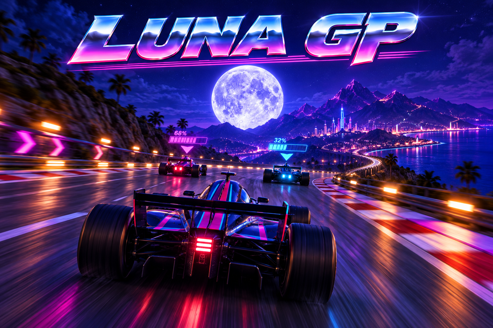
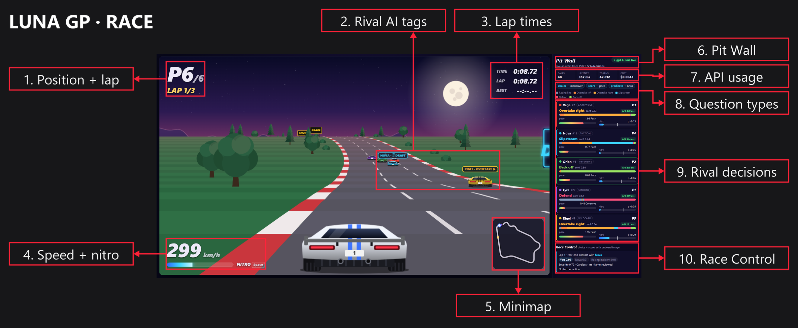
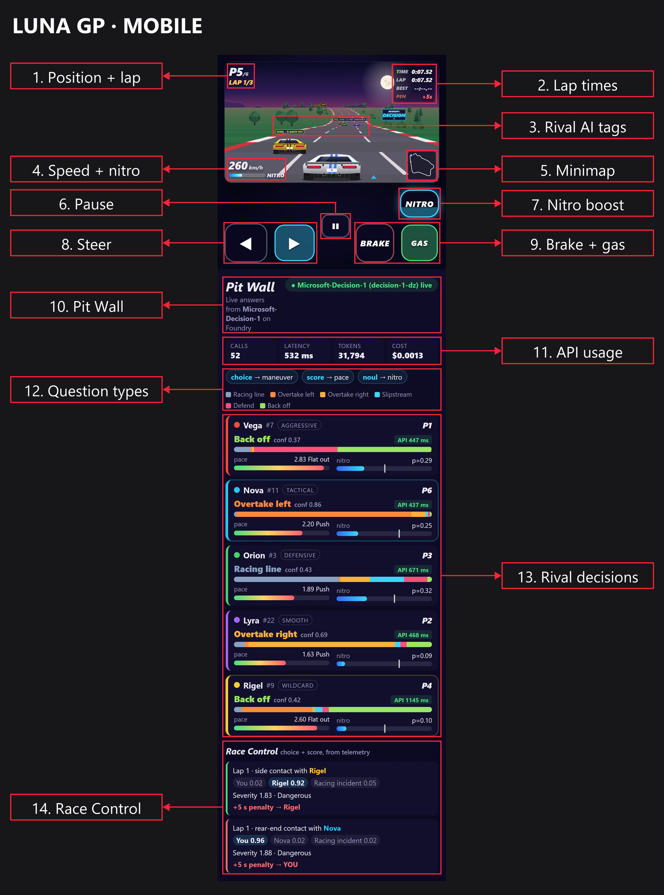
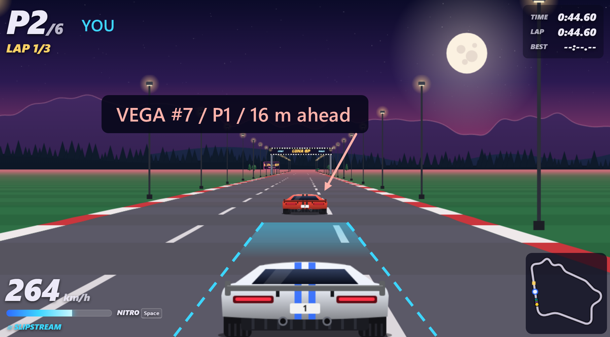
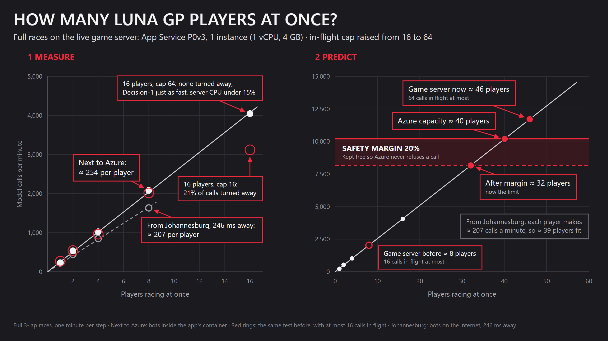

# LUNA GP



A pseudo-3D night-time arcade racer whose rival drivers, race stewards and post-race debrief are powered by
[Microsoft-Decision-1](https://ai.azure.com/catalog/models/Microsoft-Decision-1) on Microsoft Foundry. You drive and the
game handles physics; the model answers typed questions (`choice`, `score`, `noul`) with probabilities instead of text.

Play it at [aka.ms/racing](https://aka.ms/racing).



## Run it locally

Requires Node.js 20+ and the Azure CLI signed in (`az login`) with access to the Foundry resource. There are no npm
dependencies.

```powershell
$env:FOUNDRY_ENDPOINT = "https://<foundry-resource>.cognitiveservices.azure.com"
npm start
```

Open <http://127.0.0.1:3000>. Without `FOUNDRY_ENDPOINT`, the rivals use offline heuristics.

## Controls

| Key              | Action                                 |
| ---------------- | -------------------------------------- |
| ← → (or A D)     | Steer                                  |
| ↑ / ↓ (or W / S) | Throttle / brake                       |
| Space (or Shift) | Nitro (recharges faster in a slipstream) |
| P (or Esc)       | Pause                                  |
| L                | Toggle the AI tags above rival cars    |
| M / B            | Mute / music on and off                |
| Enter            | Start / race again                     |

Touch screens get on-screen steering, GAS, BRAKE and NITRO buttons; hold the phone sideways for the biggest view.



## Slipstream and strategy



Within 3–28 m behind a car, lined up with it and above 150 km/h, you get a tow: +6% top speed and nitro refills about six
times faster. Nitro gives +22% top speed for 2.2 s. Race Control penalizes contact: +2 s careless, +5 s dangerous.

The tag above each rival shows its latest maneuver:

| Tag | The rival is… | Your move |
| --- | --- | --- |
| **LINE** | on the racing line | Pass on a straight |
| **◀ OVERTAKE** / **OVERTAKE ▶** | pulling out to pass | Hold your line |
| **≋ DRAFT** | in the slipstream of the car ahead | Keep a boost to answer its attack |
| **■ DEFEND** | covering your line | Feint, then switch sides |
| **▼ BACK OFF** | leaving room | Take the gap |

## How Microsoft-Decision-1 is used

| Who | When | Questions |
| --- | --- | --- |
| **Each rival** (5 cars) | Every 0.65–1.8 s | `choice` maneuver, `score` pace, `noul` fire nitro? |
| **Race Control** | After contact with a rival | `choice` who is responsible, `score` severity |
| **Debrief** | After the race | `score` rating, `choice` driver of the day, `noul` clean racer? |

Each request describes the situation in plain text from that driver's point of view. If the API fails, rivals fall back
to offline heuristics and the race carries on. A rival decision is about 630 input tokens, and a race makes about 250
calls a minute.

## Deploy to Azure

The game runs on App Service (Linux, Node 22) and calls the model with its system-assigned managed identity.

```powershell
$rg = "<resource-group>"; $app = "luna-gp-<unique>"; $plan = "<app-service-plan>"; $foundry = "<foundry-resource>"

az cognitiveservices account deployment create -g $rg -n $foundry --deployment-name decision-1-dz `
  --model-name Microsoft-Decision-1 --model-version 1 --model-format Microsoft --sku-name DataZoneStandard --sku-capacity 500
az appservice plan create -g $rg -n $plan -l centralus --is-linux --sku P0v3
az webapp create -g $rg -p $plan -n $app --runtime "NODE:22-lts" --assign-identity "[system]"
az webapp config set -g $rg -n $app --startup-file "node server.js" --always-on true --min-tls-version 1.2 --ftps-state Disabled
az webapp update -g $rg -n $app --https-only true

$principal = az webapp identity show -g $rg -n $app --query principalId -o tsv
$scope = az cognitiveservices account show -g $rg -n $foundry --query id -o tsv
az role assignment create --assignee-object-id $principal --assignee-principal-type ServicePrincipal `
  --role "Cognitive Services User" --scope $scope

az webapp config appsettings set -g $rg -n $app --settings `
  FOUNDRY_ENDPOINT=https://$foundry.cognitiveservices.azure.com FOUNDRY_DEPLOYMENT=decision-1-dz HOST=0.0.0.0
tar -a -c -f luna-gp.zip server.js package.json lib public
az webapp deploy -g $rg -n $app --src-path luna-gp.zip --type zip
```

The app is public: the server caps work at 64 calls in flight and `DAILY_CALL_LIMIT` model calls a UTC day, then rivals
use offline heuristics.

## Configuration

| Variable             | Default         | Purpose                                                  |
| -------------------- | --------------- | -------------------------------------------------------- |
| `FOUNDRY_ENDPOINT`   | –               | Foundry resource endpoint (required for AI rivals)       |
| `FOUNDRY_DEPLOYMENT` | `decision-1-dz` | Model deployment name                                    |
| `FOUNDRY_API_KEY`    | unset           | Optional key auth; otherwise managed identity or Azure CLI |
| `PORT` / `HOST`      | `3000` / `127.0.0.1` | Listen address (`0.0.0.0` on App Service)           |
| `DAILY_CALL_LIMIT`   | `20000`         | Most model calls per UTC day                             |
| `LOG_DECISIONS`      | unset           | `1` logs every decision                                  |

## Speed duel and load test

- **Speed duel** (`/duel.html`, or `npm run bench`): races one batched call against three parallel or sequential
  single-question calls. One batched call is as fast as parallel calls and uses about 40% fewer tokens.
- **Load test** (`npm run loadtest`): bot players race against a game server and `npm run loadtest -- chart` predicts
  how many fit. Runs are in [`docs/load-test/`](docs/load-test/); `--help` lists the options.



## Tests

`npm test` runs the node:test suites; they make no network calls.